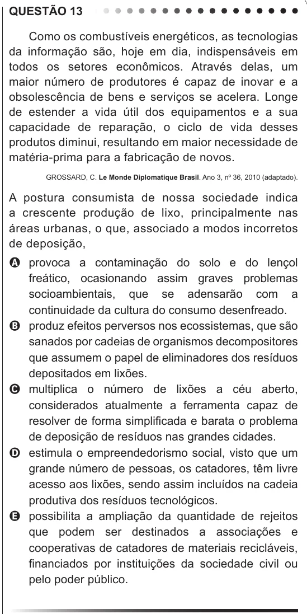

Texto extraído (pode conter ruído)

QUESTÃO 13  
Como os combustíveis energéticos, as tecnologias  
da informação são, hoje em dia, indispensáveis em  
todos os setores econômicos. Através delas, um  
maior número de produtores é capaz de inovar e a  
obsolescência de bens e serviços se acelera. Longe  
de estender a vida útil dos equipamentos e a sua  
capacidade de reparação, o ciclo de vida desses  
produtos diminui, resultando em maior necessidade de  
matéria-prima para a fabricação de novos.  
GROSSARD, C. Le Monde Diplomatique Brasil. Ano 3, nº 36, 2010 (adaptado).  
A postura consumista de nossa sociedade indica  
a crescente produção de lixo, principalmente nas  
áreas urbanas, o que, associado a modos incorretos  
de deposição,  
A provoca a contaminação do solo e do lençol  
freático, ocasionando assim graves problemas  
socioambientais, que se adensarão com a  
continuidade da cultura do consumo desenfreado.  
B produz efeitos perversos nos ecossistemas, que são  
sanados por cadeias de organismos decompositores  
que assumem o papel de eliminadores dos resíduos  
depositados em lixões.  
C multiplica o número de lixões a céu aberto,  
considerados atualmente a ferramenta capaz de  
resolver de forma simplificada e barata o problema  
de deposição de resíduos nas grandes cidades.  
D estimula o empreendedorismo social, visto que um  
grande número de pessoas, os catadores, têm livre  
acesso aos lixões, sendo assim incluídos na cadeia  
produtiva dos resíduos tecnológicos.  
E possibilita a ampliação da quantidade de rejeitos  
que podem ser destinados a associações e  
cooperativas de catadores de materiais recicláveis,  
financiados por instituições da sociedade civil ou  
pelo poder público.

