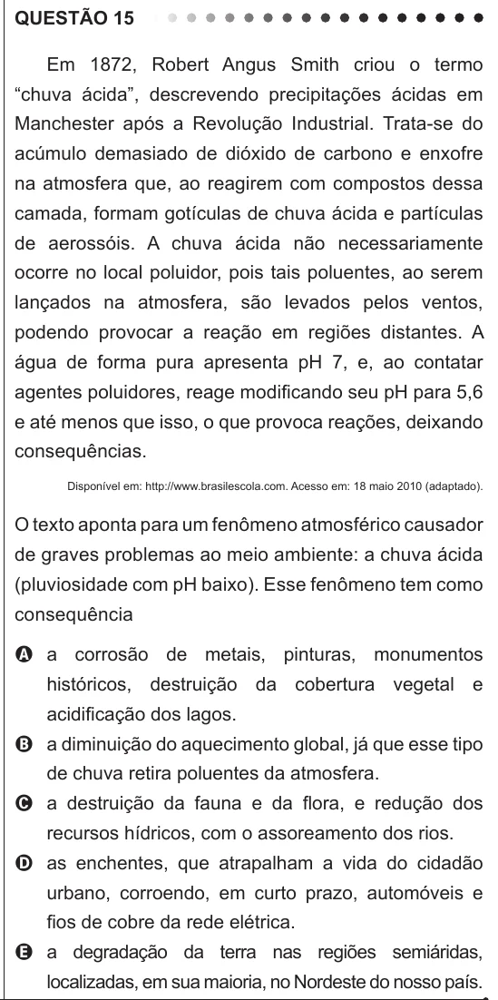

Texto extraído (pode conter ruído)

QUESTÃO 15  
Em 1872, Robert Angus Smith criou o termo  
“chuva ácida”, descrevendo precipitações ácidas em  
Manchester após a Revolução Industrial. Trata-se do  
acúmulo demasiado de dióxido de carbono e enxofre  
na atmosfera que, ao reagirem com compostos dessa  
camada, formam gotículas de chuva ácida e partículas  
de aerossóis. A chuva ácida não necessariamente  
ocorre no local poluidor, pois tais poluentes, ao serem  
lançados na atmosfera, são levados pelos ventos,  
podendo provocar a reação em regiões distantes. A  
água de forma pura apresenta pH 7, e, ao contatar  
agentes poluidores, reage modificando seu pH para 5,6  
e até menos que isso, o que provoca reações, deixando  
consequências.  
Disponível em: http://www.brasilescola.com. Acesso em: 18 maio 2010 (adaptado).  
O texto aponta para um fenômeno atmosférico causador  
de graves problemas ao meio ambiente: a chuva ácida  
(pluviosidade com pH baixo). Esse fenômeno tem como  
consequência  
A a corrosão de metais, pinturas, monumentos  
históricos, destruição da cobertura vegetal e  
acidificação dos lagos.  
B a diminuição do aquecimento global, já que esse tipo  
de chuva retira poluentes da atmosfera.  
C a destruição da fauna e da flora, e redução dos  
recursos hídricos, com o assoreamento dos rios.  
D as enchentes, que atrapalham a vida do cidadão  
urbano, corroendo, em curto prazo, automóveis e  
fios de cobre da rede elétrica.  
E a degradação da terra nas regiões semiáridas,  
localizadas, em sua maioria, no Nordeste do nosso país.

