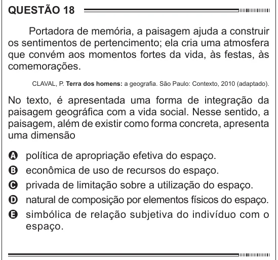

Texto extraído (pode conter ruído)

QUESTÃO 18  
Portadora de memória, a paisagem ajuda a construir  
os sentimentos de pertencimento; ela cria uma atmosfera  
que convém aos momentos fortes da vida, às festas, às  
comemorações.  
CLAVAL, P. Terra dos homens: a geografia. São Paulo: Contexto, 2010 (adaptado).  
No texto, é apresentada uma forma de integração da  
paisagem geográfica com a vida social. Nesse sentido, a  
paisagem, além de existir como forma concreta, apresenta  
uma dimensão  
A  
política de apropriação efetiva do espaço.  
econômica de uso de recursos do espaço.  
B  
privada de limitação sobre a utilização do espaço.  
C  
D  
natural de composição por elementos físicos do espaço.  
simbólica de relação subjetiva do indivíduo com o  
E  
espaço.

