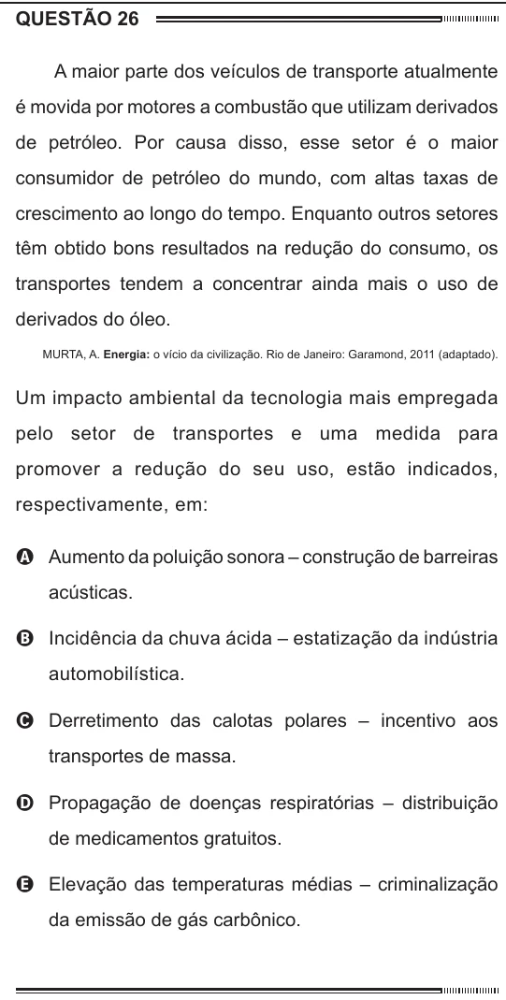

Texto extraído (pode conter ruído)

QUESTÃO 26  
A maior parte dos veículos de transporte atualmente  
é movida por motores a combustão que utilizam derivados  
de petróleo. Por causa disso, esse setor é o maior  
consumidor de petróleo do mundo, com altas taxas de  
crescimento ao longo do tempo. Enquanto outros setores  
têm obtido bons resultados na redução do consumo, os  
transportes tendem a concentrar ainda mais o uso de  
derivados do óleo.  
MURTA, A. Energia: o vício da civilização. Rio de Janeiro: Garamond, 2011 (adaptado).  
Um impacto ambiental da tecnologia mais empregada  
pelo setor de transportes e uma medida para  
promover a redução do seu uso, estão indicados,  
respectivamente, em:  
A Aumento da poluição sonora – construção de barreiras  
acústicas.  
B Incidência da chuva ácida – estatização da indústria  
automobilística.  
C Derretimento das calotas polares – incentivo aos  
transportes de massa.  
D Propagação de doenças respiratórias – distribuição  
de medicamentos gratuitos.  
E Elevação das temperaturas médias – criminalização  
da emissão de gás carbônico.

