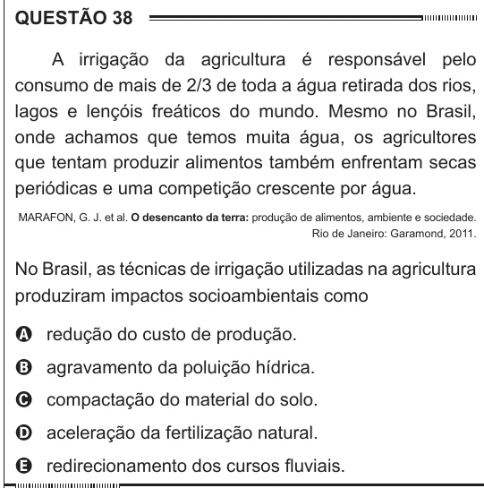

Texto extraído (pode conter ruído)

QUESTÃO 38  
A irrigação da agricultura é responsável pelo  
consumo de mais de 2/3 de toda a água retirada dos rios,  
lagos e lençóis freáticos do mundo. Mesmo no Brasil,  
onde achamos que temos muita água, os agricultores  
que tentam produzir alimentos também enfrentam secas  
periódicas e uma competição crescente por água.  
MARAFON, G. J. et al. O desencanto da terra: produção de alimentos, ambiente e sociedade.  
Rio de Janeiro: Garamond, 2011.  
No Brasil, as técnicas de irrigação utilizadas na agricultura  
produziram impactos socioambientais como  
A redução do custo de produção.  
B agravamento da poluição hídrica.  
C compactação do material do solo.  
D aceleração da fertilização natural.  
E redirecionamento dos cursos fluviais.

