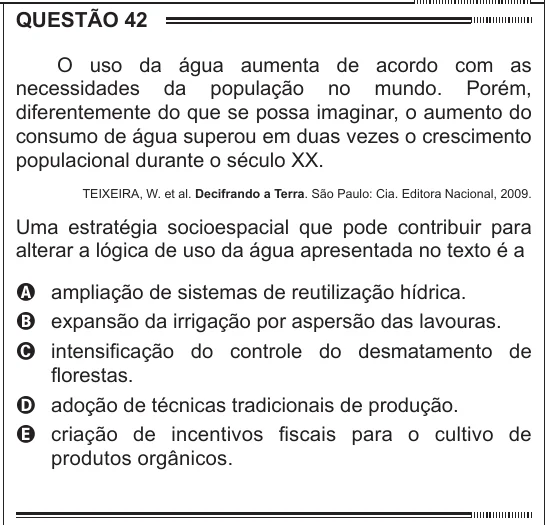

Texto extraído (pode conter ruído)

QUESTÃO 42  
O uso da água aumenta de acordo com as  
necessidades da população no mundo. Porém,  
diferentemente do que se possa imaginar, o aumento do  
consumo de água superou em duas vezes o crescimento  
populacional durante o século XX.  
TEIXEIRA, W. et al. Decifrando a Terra. São Paulo: Cia. Editora Nacional, 2009.  
Uma estratégia socioespacial que pode contribuir para  
alterar a lógica de uso da água apresentada no texto é a  
A ampliação de sistemas de reutilização hídrica.  
B expansão da irrigação por aspersão das lavouras.  
C intensificação do controle do desmatamento de  
florestas.  
D adoção de técnicas tradicionais de produção.  
E criação de incentivos fiscais para o cultivo de  
produtos orgânicos.

