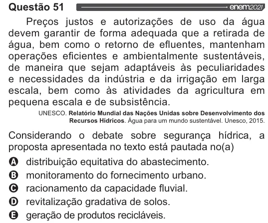

Texto extraído (pode conter ruído)

Questão 51  
Preços justos e autorizações de uso da água  
devem garantir de forma adequada que a retirada de  
água, bem como o retorno de efluentes, mantenham  
operações eficientes e ambientalmente sustentáveis,  
de maneira que sejam adaptáveis às peculiaridades  
e necessidades da indústria e da irrigação em larga  
escala, bem como às atividades da agricultura em  
pequena escala e de subsistência.  
UNESCO. Relatório Mundial das Nações Unidas sobre Desenvolvimento dos  
Recursos Hídricos. Água para um mundo sustentável. Unesco, 2015.  
Considerando o debate sobre segurança hídrica, a  
proposta apresentada no texto está pautada no(a)  
distribuição equitativa do abastecimento.  
monitoramento do fornecimento urbano.  
racionamento da capacidade fluvial.  
revitalização gradativa de solos.  
geração de produtos recicláveis.

