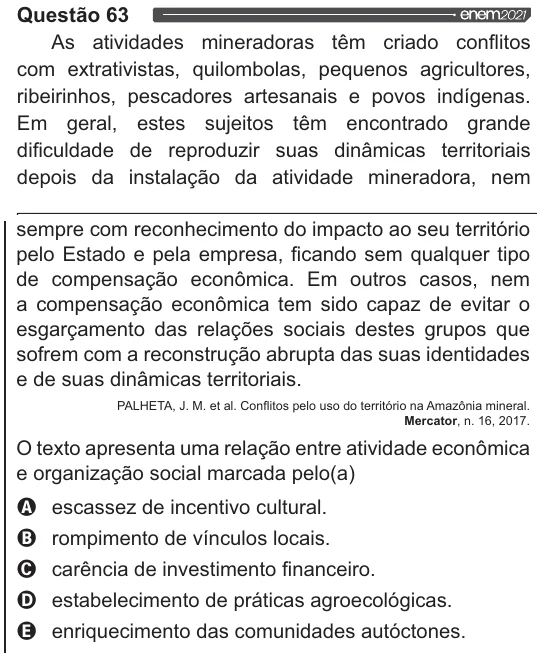

Texto extraído (pode conter ruído)

Questão 63  
As atividades mineradoras têm criado conflitos  
com extrativistas, quilombolas, pequenos agricultores,  
ribeirinhos, pescadores artesanais e povos indígenas.  
Em geral, estes sujeitos têm encontrado grande  
dificuldade de reproduzir suas dinâmicas territoriais  
depois da instalação da atividade mineradora, nem  
sempre com reconhecimento do impacto ao seu território  
pelo Estado e pela empresa, ficando sem qualquer tipo  
de compensação econômica. Em outros casos, nem  
a compensação econômica tem sido capaz de evitar o  
esgarçamento das relações sociais destes grupos que  
sofrem com a reconstrução abrupta das suas identidades  
e de suas dinâmicas territoriais.  
PALHETA, J. M. et al. Conflitos pelo uso do território na Amazônia mineral.  
Mercator, n. 16, 2017.  
O texto apresenta uma relação entre atividade econômica  
e organização social marcada pelo(a)  
Q escassez de incentivo cultural.  
O rompimento de vínculos locais.  
O carência de investimento financeiro.  
estabelecimento de práticas agroecológicas.  
enriquecimento das comunidades autóctones.

