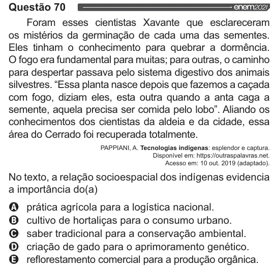

Texto extraído (pode conter ruído)

Questão 70  
Foram esses cientistas Xavante que esclareceram  
os mistérios da germinação de cada uma das sementes.  
Eles tinham o conhecimento para quebrar a dormência.  
O fogo era fundamental para muitas; para outras, o caminho  
para despertar passava pelo sistema digestivo dos animais  
silvestres. “Essa planta nasce depois que fazemos a caçada  
com fogo, diziam eles, esta outra quando a anta caga a  
semente, aquela precisa ser comida pelo lobo”. Aliando os  
conhecimentos dos cientistas da aldeia e da cidade, essa  
área do Cerrado foi recuperada totalmente.  
PAPPIANI, A. Tecnologias indígenas: esplendor e captura.  
Disponível em: https://outraspalavras.net.  
Acesso em: 10 out. 2019 (adaptado).  
No texto, a relação socioespacial dos indígenas evidencia  
a importância do(a)  
VOVOO  
prática agrícola para a logística nacional.  
cultivo de hortaliças para o consumo urbano.  
saber tradicional para a conservação ambiental.  
criação de gado para o aprimoramento genético.  
reflorestamento comercial para a produção orgânica.

