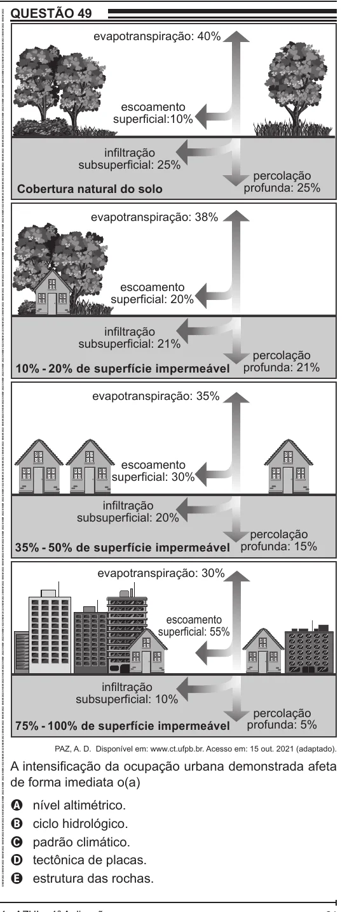

Texto extraído (pode conter ruído)

QUESTÃO 49  
ENEM 2022 ENEM 2022 ENEM 2022 ENEM 2022 ENEM 2022 ENEM 2022 ENEM 2022 ENEM 2022 ENEM 2022 ENEM 2022 ENEM 2022 ENEM 2022 ENEM 2022 ENEM 2022 ENEM 2022 ENEM 2022 ENEM 2022 ENEM 2022 ENEM 2022 ENEM 2022 ENEM 2022 ENEM 2022 ENEM 2022 ENEM 2022 ENEM 2022 ENEM 2022 ENEM 2022 ENEM 2022 ENEM 2022 ENEM 2022 ENEM 2022 ENEM 2022 ENEM 2022 ENEM 2022 ENEM 2022 ENEM 2022 ENEM 2022 ENEM 2022 ENEM 2022 ENEM 2022 ENEM 2022 ENEM 2022 ENEM 2022 ENEM 2022 ENEM 2022 ENEM 2022 ENEM 2022 ENEM 2022 ENEM 2022 ENEM 2022 ENEM 2022 ENEM 2022 ENEM 2022 ENEM 2022 ENEM 2022 ENEM 2022 ENEM 2022 ENEM 2022 ENEM 2022 ENEM 2022 ENEM 2022 ENEM 2022 ENEM 2022  
evapotranspiração: 40%  
escoamento  
superficial:10%  
infiltração  
subsuperficial: 25%  
percolação  
Cobertura natural do solo  
profunda: 25%  
evapotranspiração: 38%  
escoamento  
superficial: 20%  
infiltração  
subsuperficial: 21%  
percolação  
10% - 20% de superfície impermeável  
profunda: 21%  
evapotranspiração: 35%  
escoamento  
superficial: 30%  
infiltração  
subsuperficial: 20%  
percolação  
35% - 50% de superfície impermeável profunda: 15%  
evapotranspiração: 30%  
escoamento  
superficial: 55%  
infiltração  
subsuperficial: 10%  
percolação  
75% - 100% de superfície impermeável  
profunda: 5%  
PAZ, A. D. Disponível em: www.ct.ufpb.br. Acesso em: 15 out. 2021 (adaptado).  
A intensificação da ocupação urbana demonstrada afeta  
de forma imediata o(a)  
A  
nível altimétrico.  
ciclo hidrológico.  
B  
padrão climático.  
C  
tectônica de placas.  
D  
estrutura das rochas.  
E

