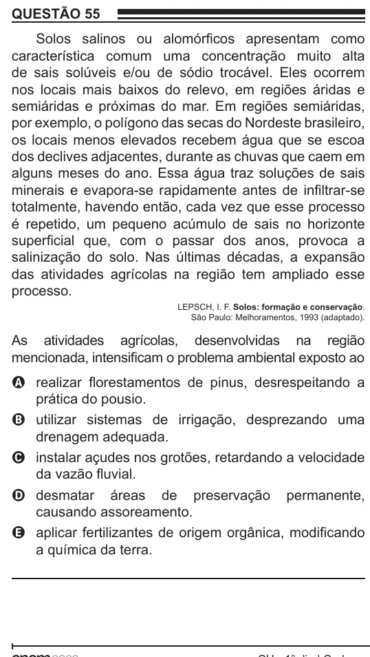

Texto extraído (pode conter ruído)

QUESTÃO 55  
Solos salinos ou alomórficos apresentam como  
característica comum uma concentração muito alta  
de sais solúveis e/ou de sódio trocável. Eles ocorrem  
nos locais mais baixos do relevo, em regiões áridas e  
semiáridas e próximas do mar. Em regiões semiáridas,  
por exemplo, o polígono das secas do Nordeste brasileiro,  
os locais menos elevados recebem água que se escoa  
dos declives adjacentes, durante as chuvas que caem em  
alguns meses do ano. Essa água traz soluções de sais  
minerais e evapora-se rapidamente antes de infiltrar-se  
totalmente, havendo então, cada vez que esse processo  
é repetido, um pequeno acúmulo de sais no horizonte  
superficial que, com o passar dos anos, provoca a  
salinização do solo. Nas últimas décadas, a expansão  
das atividades agrícolas na região tem ampliado esse  
processo.  
LEPSCH, I. F. Solos: formação e conservação.  
São Paulo: Melhoramentos, 1993 (adaptado).  
As atividades agrícolas, desenvolvidas na região  
mencionada, intensificam o problema ambiental exposto ao  
A realizar florestamentos de pinus, desrespeitando a  
prática do pousio.  
B utilizar sistemas de irrigação, desprezando uma  
drenagem adequada.  
C instalar açudes nos grotões, retardando a velocidade  
da vazão fluvial.  
D desmatar áreas de preservação permanente,  
causando assoreamento.  
E aplicar fertilizantes de origem orgânica, modificando  
a química da terra.

