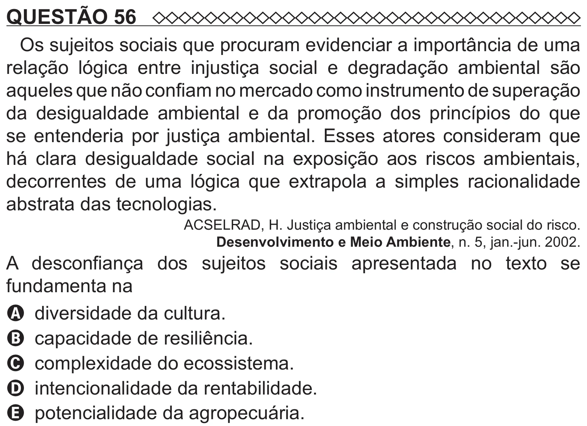

Texto extraído (pode conter ruído)

QUESTÃO 56  
Os sujeitos sociais que procuram evidenciar a importância de uma  
relação lógica entre injustiça social e degradação ambiental são  
aqueles que não confiam no mercado como instrumento de superação  
da desigualdade ambiental e da promoção dos princípios do que  
se entenderia por justiça ambiental. Esses atores consideram que  
há clara desigualdade social na exposição aos riscos ambientais,  
decorrentes de uma lógica que extrapola a simples racionalidade  
abstrata das tecnologias.  
ACSELRAD, H. Justiça ambiental e construção social do risco.  
Desenvolvimento e Meio Ambiente, n. 5, jan.-jun. 2002.  
A desconfiança dos sujeitos sociais apresentada no texto se  
fundamenta na  
A diversidade da cultura.  
B capacidade de resiliência.  
C complexidade do ecossistema.  
D intencionalidade da rentabilidade.  
E potencialidade da agropecuária.

