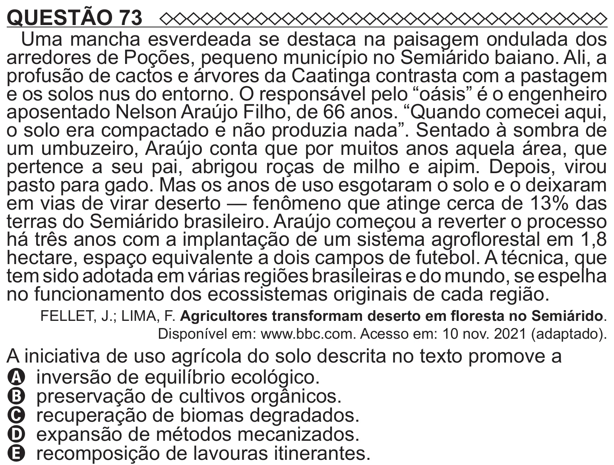

Texto extraído (pode conter ruído)

QUESTÃO 73  
Uma mancha esverdeada se destaca na paisagem ondulada dos  
arredores de Poções, pequeno município no Semiárido baiano. Ali, a  
profusão de cactos e árvores da Caatinga contrasta com a pastagem  
e os solos nus do entorno. O responsável pelo “oásis” é o engenheiro  
aposentado Nelson Araújo Filho, de 66 anos. “Quando comecei aqui,  
o solo era compactado e não produzia nada”. Sentado à sombra de  
um umbuzeiro, Araújo conta que por muitos anos aquela área, que  
pertence a seu pai, abrigou roças de milho e aipim. Depois, virou  
pasto para gado. Mas os anos de uso esgotaram o solo e o deixaram  
em vias de virar deserto — fenômeno que atinge cerca de 13% das  
terras do Semiárido brasileiro. Araújo começou a reverter o processo  
há três anos com a implantação de um sistema agroflorestal em 1,8  
hectare, espaço equivalente a dois campos de futebol. A técnica, que  
tem sido adotada em várias regiões brasileiras e do mundo, se espelha  
no funcionamento dos ecossistemas originais de cada região.  
FELLET, J.; LIMA, F. Agricultores transformam deserto em floresta no Semiárido.  
Disponível em: www.bbc.com. Acesso em: 10 nov. 2021 (adaptado).  
A iniciativa de uso agrícola do solo descrita no texto promove a  
A inversão de equilíbrio ecológico.  
B preservação de cultivos orgânicos.  
C recuperação de biomas degradados.  
D expansão de métodos mecanizados.

