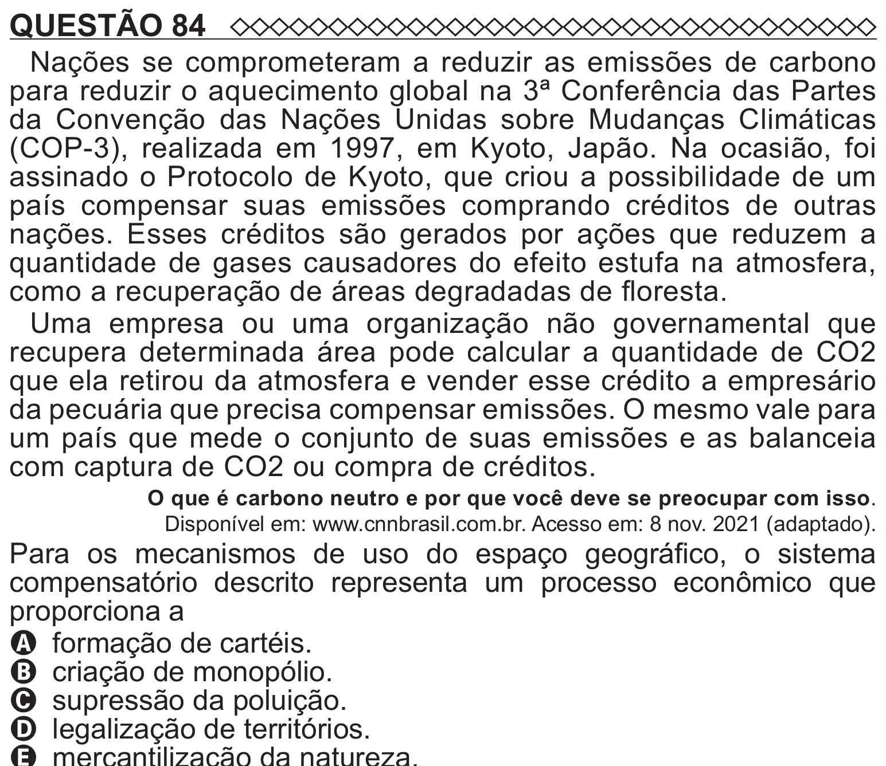

Texto extraído (pode conter ruído)

QUESTÃO 84  
Nações se comprometeram a reduzir as emissões de carbono  
para reduzir o aquecimento global na 3ª Conferência das Partes  
da Convenção das Nações Unidas sobre Mudanças Climáticas  
(COP-3), realizada em 1997, em Kyoto, Japão. Na ocasião, foi  
assinado o Protocolo de Kyoto, que criou a possibilidade de um  
país compensar suas emissões comprando créditos de outras  
nações. Esses créditos são gerados por ações que reduzem a  
quantidade de gases causadores do efeito estufa na atmosfera,  
como a recuperação de áreas degradadas de floresta.  
Uma empresa ou uma organização não governamental que  
recupera determinada área pode calcular a quantidade de CO2  
que ela retirou da atmosfera e vender esse crédito a empresário  
da pecuária que precisa compensar emissões. O mesmo vale para  
um país que mede o conjunto de suas emissões e as balanceia  
com captura de CO2 ou compra de créditos.  
O que é carbono neutro e por que você deve se preocupar com isso.  
Disponível em: www.cnnbrasil.com.br. Acesso em: 8 nov. 2021 (adaptado).  
Para os mecanismos de uso do espaço geográfico, o sistema  
compensatório descrito representa um processo econômico que  
proporciona a  
A formação de cartéis.  
B criação de monopólio.  
C supressão da poluição.  
D legalização de territórios.

