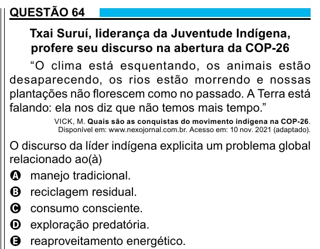

Texto extraído (pode conter ruído)

QUESTÃO 64  
Txai Suruí, liderança da Juventude Indígena,  
profere seu discurso na abertura da COP-26  
“O clima está esquentando, os animais estão  
desaparecendo, os rios estão morrendo e nossas  
plantações não florescem como no passado. A Terra está  
falando: ela nos diz que não temos mais tempo.”  
VICK, M. Quais são as conquistas do movimento indígena na COP-26.  
Disponível em: www.nexojornal.com.br. Acesso em: 10 nov. 2021 (adaptado).  
O discurso da líder indígena explicita um problema global  
relacionado ao(à)  
A manejo tradicional.  
B reciclagem residual.  
C consumo consciente.  
D exploração predatória.  
E reaproveitamento energético.

