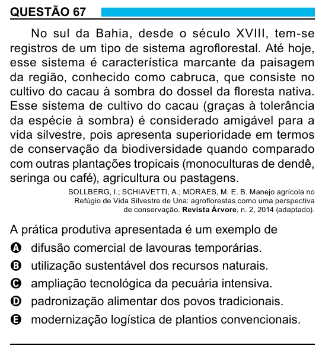

Texto extraído (pode conter ruído)

QUESTÃO 67  
No sul da Bahia, desde o século XVIII, tem-se  
registros de um tipo de sistema agroflorestal. Até hoje,  
esse sistema é característica marcante da paisagem  
da região, conhecido como cabruca, que consiste no  
cultivo do cacau à sombra do dossel da floresta nativa.  
Esse sistema de cultivo do cacau (graças à tolerância  
da espécie à sombra) é considerado amigável para a  
vida silvestre, pois apresenta superioridade em termos  
de conservação da biodiversidade quando comparado  
com outras plantações tropicais (monoculturas de dendê,  
seringa ou café), agricultura ou pastagens.  
SOLLBERG, I.; SCHIAVETTI, A.; MORAES, M. E. B. Manejo agrícola no  
Refúgio de Vida Silvestre de Una: agroflorestas como uma perspectiva  
de conservação. Revista Árvore, n. 2, 2014 (adaptado).  
A prática produtiva apresentada é um exemplo de  
A difusão comercial de lavouras temporárias.  
B utilização sustentável dos recursos naturais.  
C ampliação tecnológica da pecuária intensiva.  
D padronização alimentar dos povos tradicionais.  
E modernização logística de plantios convencionais.

