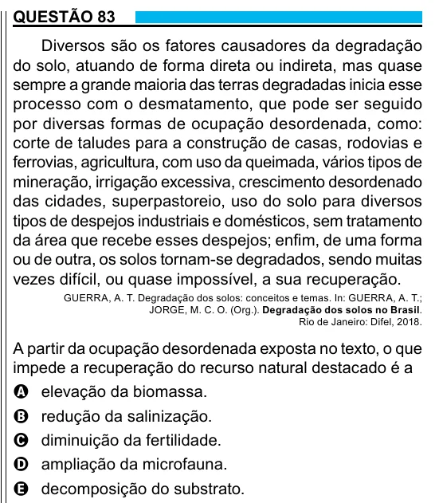

Texto extraído (pode conter ruído)

QUESTÃO 83  
Diversos são os fatores causadores da degradação  
do solo, atuando de forma direta ou indireta, mas quase  
sempre a grande maioria das terras degradadas inicia esse  
processo com o desmatamento, que pode ser seguido  
por diversas formas de ocupação desordenada, como:  
corte de taludes para a construção de casas, rodovias e  
ferrovias, agricultura, com uso da queimada, vários tipos de  
mineração, irrigação excessiva, crescimento desordenado  
das cidades, superpastoreio, uso do solo para diversos  
tipos de despejos industriais e domésticos, sem tratamento  
da área que recebe esses despejos; enfim, de uma forma  
ou de outra, os solos tornam-se degradados, sendo muitas  
vezes difícil, ou quase impossível, a sua recuperação.  
GUERRA, A. T. Degradação dos solos: conceitos e temas. In: GUERRA, A. T.;  
JORGE, M. C. O. (Org.). Degradação dos solos no Brasil.  
Rio de Janeiro: Difel, 2018.  
A partir da ocupação desordenada exposta no texto, o que  
impede a recuperação do recurso natural destacado é a  
A elevação da biomassa.  
B redução da salinização.  
C diminuição da fertilidade.  
D ampliação da microfauna.  
E decomposição do substrato.

