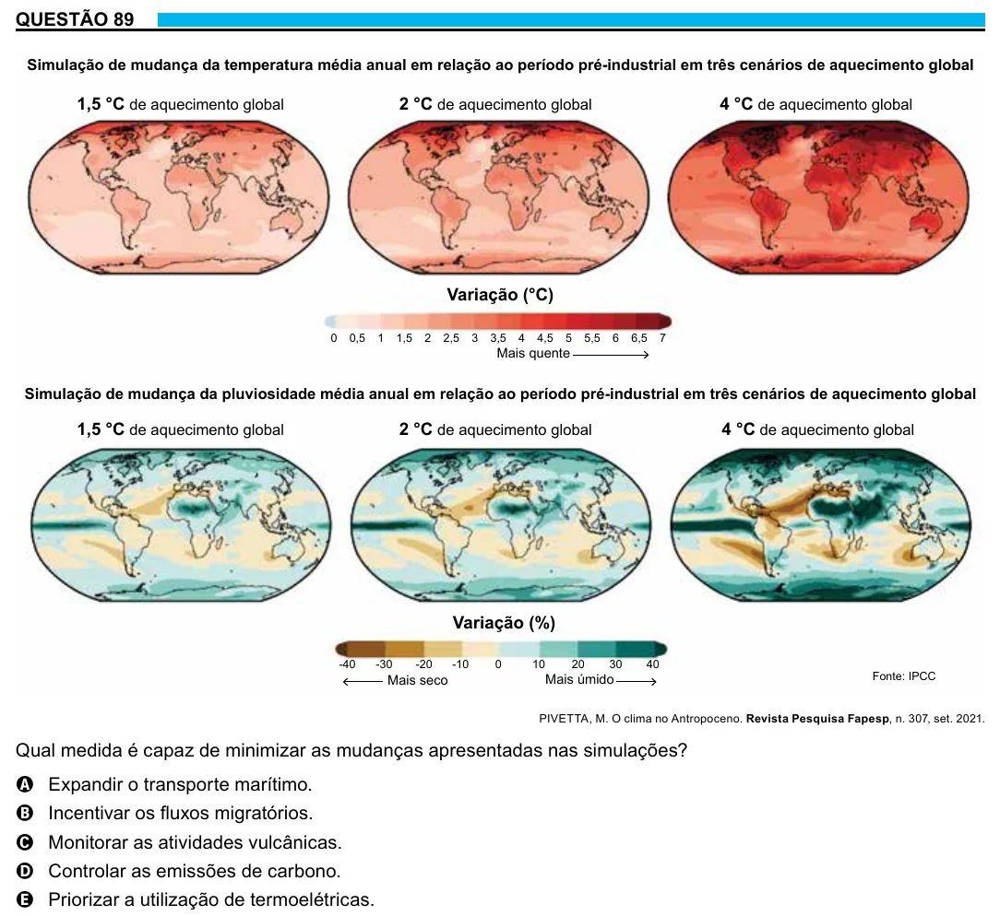

Texto extraído (pode conter ruído)

QUESTÃO 89  
Simulação de mudança da temperatura média anual em relação ao período pré-industrial em três cenários de aquecimento global  
1,5 °C de aquecimento global  
2 °C de aquecimento global  
4 °C de aquecimento global  
Variação (°C)  
0  
0,5  
1  
1,5  
2  
2,5  
3  
3,5  
4  
4,5  
5  
5,5  
6  
6,5  
7  
Mais quente  
Simulação de mudança da pluviosidade média anual em relação ao período pré-industrial em três cenários de aquecimento global  
1,5 °C de aquecimento global  
2 °C de aquecimento global  
4 °C de aquecimento global  
Variação (%)  
-40  
-30  
-20  
-10  
0  
10  
20  
30  
40  
Mais seco  
Mais úmido  
Fonte: IPCC  
PIVETTA, M. O clima no Antropoceno. Revista Pesquisa Fapesp, n. 307, set. 2021.  
Qual medida é capaz de minimizar as mudanças apresentadas nas simulações?  
A Expandir o transporte marítimo.  
B Incentivar os fluxos migratórios.  
C Monitorar as atividades vulcânicas.  
D Controlar as emissões de carbono.  
E Priorizar a utilização de termoelétricas.

