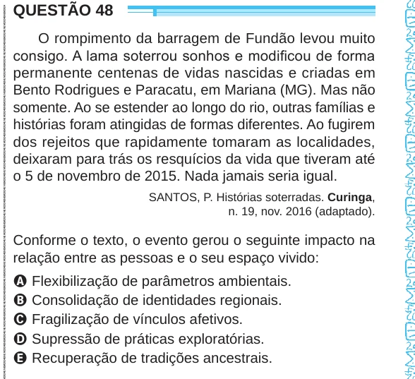

Texto extraído (pode conter ruído)

QUESTÃO 48  
O rompimento da barragem de Fundão levou muito  
consigo. A lama soterrou sonhos e modificou de forma  
permanente centenas de vidas nascidas e criadas em  
Bento Rodrigues e Paracatu, em Mariana (MG). Mas não  
somente. Ao se estender ao longo do rio, outras famílias e  
histórias foram atingidas de formas diferentes. Ao fugirem  
dos rejeitos que rapidamente tomaram as localidades,  
deixaram para trás os resquícios da vida que tiveram até  
o 5 de novembro de 2015. Nada jamais seria igual.  
SANTOS, P. Histórias soterradas. Curinga,  
n. 19, nov. 2016 (adaptado).  
Conforme o texto, o evento gerou o seguinte impacto na  
relação entre as pessoas e o seu espaço vivido:  
A Flexibilização de parâmetros ambientais.  
B Consolidação de identidades regionais.  
C Fragilização de vínculos afetivos.  
D Supressão de práticas exploratórias.  
E Recuperação de tradições ancestrais.

