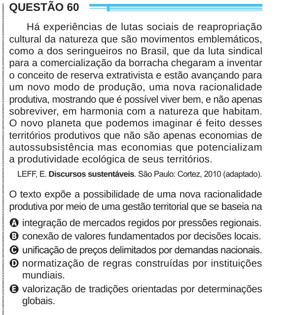

Texto extraído (pode conter ruído)

QUESTÃO 60  
Há experiências de lutas sociais de reapropriação  
cultural da natureza que são movimentos emblemáticos,  
como a dos seringueiros no Brasil, que da luta sindical  
para a comercialização da borracha chegaram a inventar  
o conceito de reserva extrativista e estão avançando para  
um novo modo de produção, uma nova racionalidade  
produtiva, mostrando que é possível viver bem, e não apenas  
sobreviver, em harmonia com a natureza que habitam.  
O novo planeta que podemos imaginar é feito desses  
territórios produtivos que não são apenas economias de  
autossubsistência mas economias que potencializam  
a produtividade ecológica de seus territórios.  
LEFF, E. Discursos sustentáveis. São Paulo: Cortez, 2010 (adaptado).  
O texto expõe a possibilidade de uma nova racionalidade  
produtiva por meio de uma gestão territorial que se baseia na  
A integração de mercados regidos por pressões regionais.  
B conexão de valores fundamentados por decisões locais.  
C unificação de preços delimitados por demandas nacionais.  
D normatização de regras construídas por instituições  
mundiais.  
E valorização de tradições orientadas por determinações  
globais.

