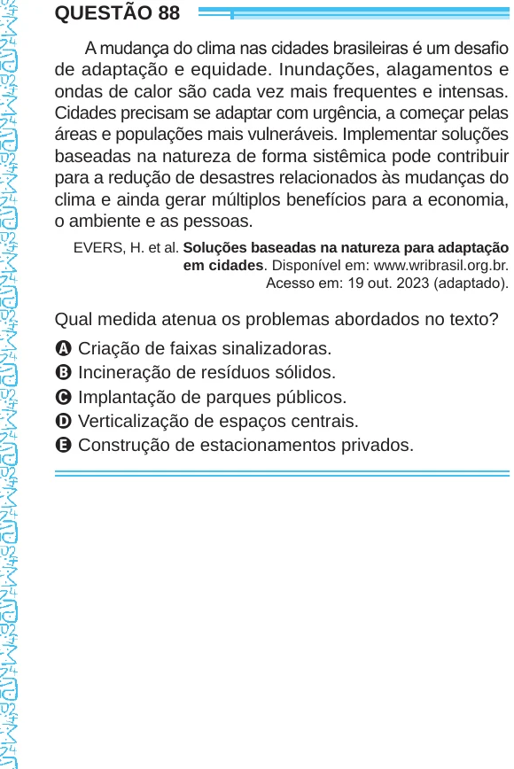

Texto extraído (pode conter ruído)

QUESTÃO 88  
A mudança do clima nas cidades brasileiras é um desafio  
de adaptação e equidade. Inundações, alagamentos e  
ondas de calor são cada vez mais frequentes e intensas.  
Cidades precisam se adaptar com urgência, a começar pelas  
áreas e populações mais vulneráveis. Implementar soluções  
baseadas na natureza de forma sistêmica pode contribuir  
para a redução de desastres relacionados às mudanças do  
clima e ainda gerar múltiplos benefícios para a economia,  
o ambiente e as pessoas.  
EVERS, H. et al. Soluções baseadas na natureza para adaptação  
em cidades. Disponível em: www.wribrasil.org.br.  
Acesso em: 19 out. 2023 (adaptado).  
Qual medida atenua os problemas abordados no texto?  
A Criação de faixas sinalizadoras.  
B Incineração de resíduos sólidos.  
C Implantação de parques públicos.  
D Verticalização de espaços centrais.  
E Construção de estacionamentos privados.

