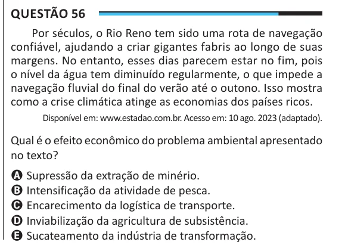

Texto extraído (pode conter ruído)

Questão 56  
Por séculos, o Rio Reno tem sido uma rota de navegação  
confiável, ajudando a criar gigantes fabris ao longo de suas  
margens. No entanto, esses dias parecem estar no fim, pois  
o nível da água tem diminuído regularmente, o que impede a  
navegação fluvial do final do verão até o outono. Isso mostra  
como a crise climática atinge as economias dos países ricos.  
Disponível em: www.estadao.com.br. Acesso em: 10 ago. 2023 (adaptado).  
Qual é o efeito econômico do problema ambiental apresentado  
no texto?  
A Supressão da extração de minério.  
B Intensificação da atividade de pesca.  
C Encarecimento da logística de transporte.  
D Inviabilização da agricultura de subsistência.  
E Sucateamento da indústria de transformação.

