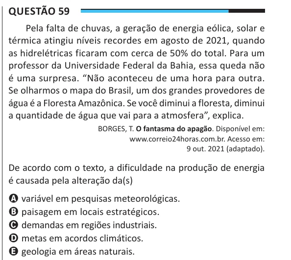

Texto extraído (pode conter ruído)

Questão 59  
Pela falta de chuvas, a geração de energia eólica, solar e  
térmica atingiu níveis recordes em agosto de 2021, quando  
as hidrelétricas ficaram com cerca de 50% do total. Para um  
professor da Universidade Federal da Bahia, essa queda não  
é uma surpresa. “Não aconteceu de uma hora para outra.  
Se olharmos o mapa do Brasil, um dos grandes provedores de  
água é a Floresta Amazônica. Se você diminui a floresta, diminui  
a quantidade de água que vai para a atmosfera”, explica.  
BORGES, T. O fantasma do apagão. Disponível em:  
www.correio24horas.com.br. Acesso em:  
9 out. 2021 (adaptado).  
De acordo com o texto, a dificuldade na produção de energia  
é causada pela alteração da(s)  
A variável em pesquisas meteorológicas.  
B paisagem em locais estratégicos.  
C demandas em regiões industriais.  
D metas em acordos climáticos.  
E geologia em áreas naturais.

