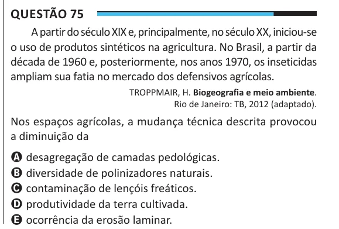

Texto extraído (pode conter ruído)

Questão 75  
A partir do século XIX e, principalmente, no século XX, iniciou-se  
o uso de produtos sintéticos na agricultura. No Brasil, a partir da  
década de 1960 e, posteriormente, nos anos 1970, os inseticidas  
ampliam sua fatia no mercado dos defensivos agrícolas.  
TROPPMAIR, H. Biogeografia e meio ambiente.  
Rio de Janeiro: TB, 2012 (adaptado).  
Nos espaços agrícolas, a mudança técnica descrita provocou  
a diminuição da  
A desagregação de camadas pedológicas.  
B diversidade de polinizadores naturais.  
C contaminação de lençóis freáticos.  
D produtividade da terra cultivada.  
E ocorrência da erosão laminar.

