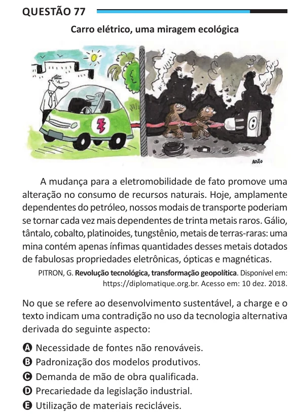

Texto extraído (pode conter ruído)

Questão 77  
Carro elétrico, uma miragem ecológica  
A mudança para a eletromobilidade de fato promove uma  
alteração no consumo de recursos naturais. Hoje, amplamente  
dependentes do petróleo, nossos modais de transporte poderiam  
se tornar cada vez mais dependentes de trinta metais raros. Gálio,  
tântalo, cobalto, platinoides, tungstênio, metais de terras-raras: uma  
mina contém apenas ínfimas quantidades desses metais dotados  
de fabulosas propriedades eletrônicas, ópticas e magnéticas.  
PITRON, G. Revolução tecnológica, transformação geopolítica. Disponível em:  
https://diplomatique.org.br. Acesso em: 10 dez. 2018.  
No que se refere ao desenvolvimento sustentável, a charge e o  
texto indicam uma contradição no uso da tecnologia alternativa  
derivada do seguinte aspecto:  
A Necessidade de fontes não renováveis.  
B Padronização dos modelos produtivos.  
C Demanda de mão de obra qualificada.  
D Precariedade da legislação industrial.  
E Utilização de materiais recicláveis.

