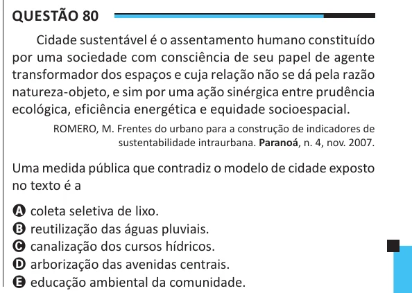

Texto extraído (pode conter ruído)

Questão 80  
Cidade sustentável é o assentamento humano constituído  
por uma sociedade com consciência de seu papel de agente  
transformador dos espaços e cuja relação não se dá pela razão  
natureza-objeto, e sim por uma ação sinérgica entre prudência  
ecológica, eficiência energética e equidade socioespacial.  
ROMERO, M. Frentes do urbano para a construção de indicadores de  
sustentabilidade intraurbana. Paranoá, n. 4, nov. 2007.  
Uma medida pública que contradiz o modelo de cidade exposto  
no texto é a  
A coleta seletiva de lixo.  
B reutilização das águas pluviais.  
C canalização dos cursos hídricos.  
D arborização das avenidas centrais.  
E educação ambiental da comunidade.

