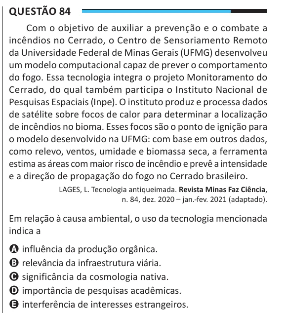

Texto extraído (pode conter ruído)

Questão 84  
Com o objetivo de auxiliar a prevenção e o combate a  
incêndios no Cerrado, o Centro de Sensoriamento Remoto  
da Universidade Federal de Minas Gerais (UFMG) desenvolveu  
um modelo computacional capaz de prever o comportamento  
do fogo. Essa tecnologia integra o projeto Monitoramento do  
Cerrado, do qual também participa o Instituto Nacional de  
Pesquisas Espaciais (Inpe). O instituto produz e processa dados  
de satélite sobre focos de calor para determinar a localização  
de incêndios no bioma. Esses focos são o ponto de ignição para  
o modelo desenvolvido na UFMG: com base em outros dados,  
como relevo, ventos, umidade e biomassa seca, a ferramenta  
estima as áreas com maior risco de incêndio e prevê a intensidade  
e a direção de propagação do fogo no Cerrado brasileiro.  
LAGES, L. Tecnologia antiqueimada. Revista Minas Faz Ciência,  
n. 84, dez. 2020 – jan.-fev. 2021 (adaptado).  
Em relação à causa ambiental, o uso da tecnologia mencionada  
indica a  
A influência da produção orgânica.  
B relevância da infraestrutura viária.  
C significância da cosmologia nativa.  
D importância de pesquisas acadêmicas.  
E interferência de interesses estrangeiros.

