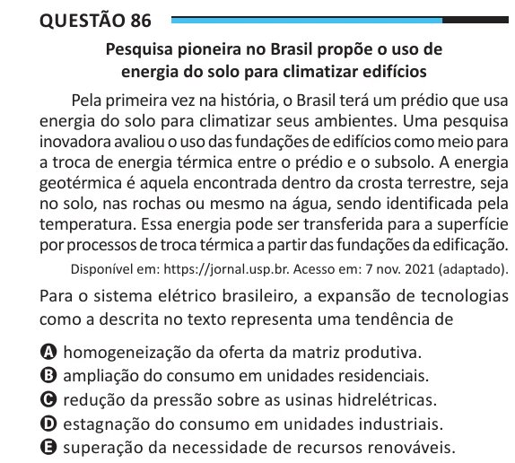

Texto extraído (pode conter ruído)

Questão 86  
Pesquisa pioneira no Brasil propõe o uso de  
energia do solo para climatizar edifícios  
Pela primeira vez na história, o Brasil terá um prédio que usa  
energia do solo para climatizar seus ambientes. Uma pesquisa  
inovadora avaliou o uso das fundações de edifícios como meio para  
a troca de energia térmica entre o prédio e o subsolo. A energia  
geotérmica é aquela encontrada dentro da crosta terrestre, seja  
no solo, nas rochas ou mesmo na água, sendo identificada pela  
temperatura. Essa energia pode ser transferida para a superfície  
por processos de troca térmica a partir das fundações da edificação.  
Disponível em: https://jornal.usp.br. Acesso em: 7 nov. 2021 (adaptado).  
Para o sistema elétrico brasileiro, a expansão de tecnologias  
como a descrita no texto representa uma tendência de  
A homogeneização da oferta da matriz produtiva.  
B ampliação do consumo em unidades residenciais.  
C redução da pressão sobre as usinas hidrelétricas.  
D estagnação do consumo em unidades industriais.  
E superação da necessidade de recursos renováveis.

