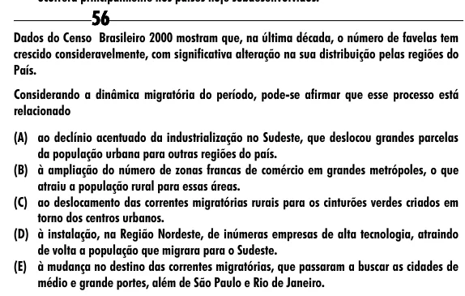

Texto extraído (pode conter ruído)

56  
Dados do Censo Brasileiro 2000 mostram que, na última década, o número de favelas tem  
crescido consideravelmente, com significativa alteração na sua distribuição pelas regiões do  
País.  
Considerando a dinâmica migratória do período, pode-se afirmar que esse processo está  
relacionado  
(A) ao declínio acentuado da industrialização no Sudeste, que deslocou grandes parcelas  
da população urbana para outras regiões do país.  
(B) à ampliação do número de zonas francas de comércio em grandes metrópoles, o que  
atraiu a população rural para essas áreas.  
(C) ao deslocamento das correntes migratórias rurais para os cinturões verdes criados em  
torno dos centros urbanos.  
(D) à instalação, na Região Nordeste, de inúmeras empresas de alta tecnologia, atraindo  
de volta a população que migrara para o Sudeste.  
(E) à mudança no destino das correntes migratórias, que passaram a buscar as cidades de  
médio e grande portes, além de São Paulo e Rio de Janeiro.

