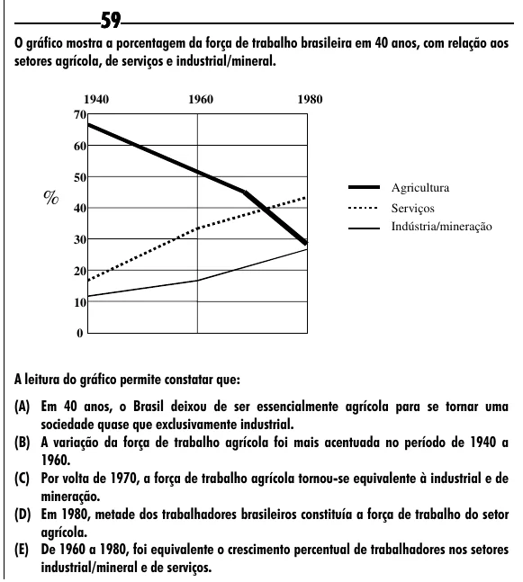

Texto extraído (pode conter ruído)

59  
O gráfico mostra a porcentagem da força de trabalho brasileira em 40 anos, com relação aos  
setores agrícola, de serviços e industrial/mineral.  
1940  
1960  
1980  
70  
60  
50  
Agricultura  
% 40  
Serviços  
Indústria/mineração  
30  
20  
10  
0  
A leitura do gráfico permite constatar que:  
(A) Em 40 anos, o Brasil deixou de ser essencialmente agrícola para se tornar uma  
sociedade quase que exclusivamente industrial.  
(B) A variação da força de trabalho agrícola foi mais acentuada no período de 1940 a  
1960.  
(C) Por volta de 1970, a força de trabalho agrícola tornou-se equivalente à industrial e de  
mineração.  
(D) Em 1980, metade dos trabalhadores brasileiros constituía a força de trabalho do setor  
agrícola.  
(E) De 1960 a 1980, foi equivalente o crescimento percentual de trabalhadores nos setores  
industrial/mineral e de serviços.

