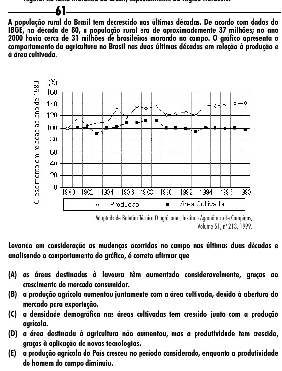

Texto extraído (pode conter ruído)

61  
A população rural do Brasil tem decrescido nas últimas décadas. De acordo com dados do  
IBGE, na década de 80, a população rural era de aproximadamente 37 milhões; no ano  
2000 havia cerca de 31 milhões de brasileiros morando no campo. O gráfico apresenta o  
comportamento da agricultura no Brasil nas duas últimas décadas em relação à produção e  
à área cultivada.  
Adaptado de Boletim Técnico O agrônomo, Instituto Agronômico de Campinas,  
Volume 51, nº 213, 1999.  
Levando em consideração as mudanças ocorridas no campo nas últimas duas décadas e  
analisando o comportamento do gráfico, é correto afirmar que  
(A) as áreas destinadas à lavoura têm aumentado consideravelmente, graças ao  
crescimento do mercado consumidor.  
(B) a produção agrícola aumentou juntamente com a área cultivada, devido à abertura do  
mercado para exportação.  
(C) a densidade demográfica nas áreas cultivadas tem crescido junto com a produção  
agrícola.  
(D) a área destinada à agricultura não aumentou, mas a produtividade tem crescido,  
graças à aplicação de novas tecnologias.  
(E) a produção agrícola do País cresceu no período considerado, enquanto a produtividade  
do homem do campo diminuiu.

