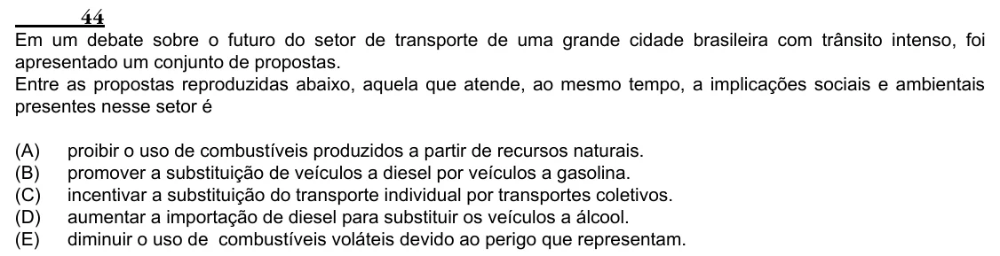

Texto extraído (pode conter ruído)

44  
Em um debate sobre o futuro do setor de transporte de uma grande cidade brasileira com trânsito intenso, foi  
apresentado um conjunto de propostas.  
Entre as propostas reproduzidas abaixo, aquela que atende, ao mesmo tempo, a implicações sociais e ambientais  
presentes nesse setor é  
(A)  
proibir o uso de combustíveis produzidos a partir de recursos naturais.  
(B)  
promover a substituição de veículos a diesel por veículos a gasolina.  
(C)  
incentivar a substituição do transporte individual por transportes coletivos.  
(D)  
aumentar a importação de diesel para substituir os veículos a álcool.  
(E)  
diminuir o uso de combustíveis voláteis devido ao perigo que representam.

