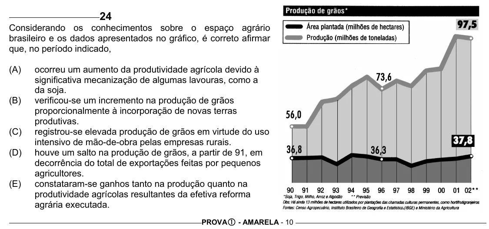

Texto extraído (pode conter ruído)

24  
Considerando os conhecimentos sobre o espaço agrário  
brasileiro e os dados apresentados no gráfico, é correto afirmar  
que, no período indicado,  
(A)  
ocorreu um aumento da produtividade agrícola devido à  
significativa mecanização de algumas lavouras, como a  
da soja.  
(B)  
verificou-se um incremento na produção de grãos  
proporcionalmente à incorporação de novas terras  
produtivas.  
(C)  
registrou-se elevada produção de grãos em virtude do uso  
intensivo de mão-de-obra pelas empresas rurais.  
(D)  
houve um salto na produção de grãos, a partir de 91, em  
decorrência do total de exportações feitas por pequenos  
agricultores.  
(E)  
constataram-se ganhos tanto na produção quanto na  
produtividade agrícolas resultantes da efetiva reforma  
agrária executada.  
PROVA c - AMARELA - 10

