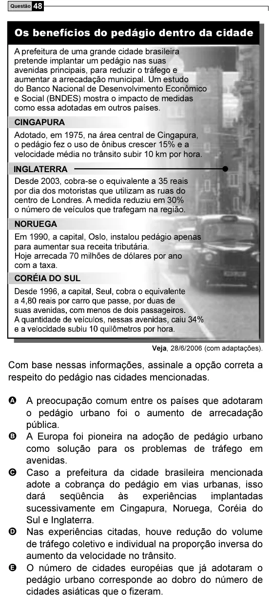

Texto extraído (pode conter ruído)

Questão 48  
Os benefícios do pedágio dentro da cidade  
A prefeitura de uma grande cidade brasileira  
pretende implantar um pedágio nas suas  
avenidas principais, para reduzir o tráfego e  
aumentar a arrecadação municipal. Um estudo  
do Banco Nacional de Desenvolvimento Econômico  
e Social (BNDES) mostra o impacto de medidas  
como essa adotadas em outros países.  
CINGAPURA  
Adotado, em 1975, na área central de Cingapura,  
o pedágio fez o uso de ônibus crescer 15% e a  
velocidade média no trânsito subir 10 km por hora.  
INGLATERRA  
Desde 2003, cobra-se o equivalente a 35 reais  
por dia dos motoristas que utilizam as ruas do  
centro de Londres. A medida reduziu em 30%  
o número de veículos que trafegam na região.  
NORUEGA  
Em 1990, a capital, Oslo, instalou pedágio apenas  
para aumentar sua receita tributária.  
Hoje arrecada 70 milhões de dólares por ano  
com a taxa.  
CORÉIA DO SUL  
Veja, 28/6/2006 (com adaptações).  
Com base nessas informações, assinale a opção correta a  
respeito do pedágio nas cidades mencionadas.  
A A preocupação comum entre os países que adotaram  
o pedágio urbano foi o aumento de arrecadação  
pública.  
B A Europa foi pioneira na adoção de pedágio urbano  
como solução para os problemas de tráfego em  
avenidas.  
C Caso a prefeitura da cidade brasileira mencionada  
adote a cobrança do pedágio em vias urbanas, isso  
dará seqüência às experiências implantadas  
sucessivamente em Cingapura, Noruega, Coréia do  
Sul e Inglaterra.  
D Nas experiências citadas, houve redução do volume  
de tráfego coletivo e individual na proporção inversa do  
aumento da velocidade no trânsito.  
E O número de cidades européias que já adotaram o  
pedágio urbano corresponde ao dobro do número de  
cidades asiáticas que o fizeram.

