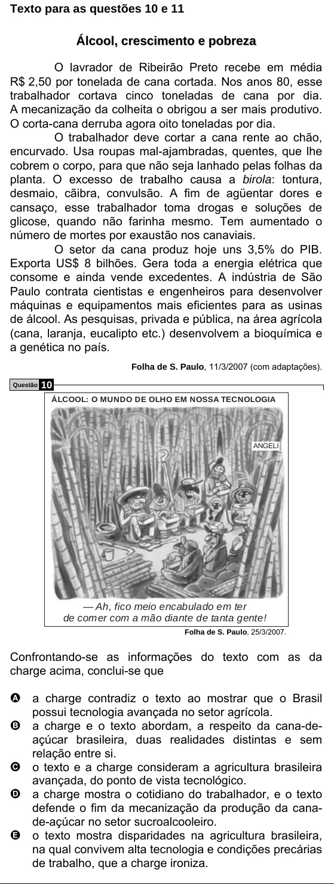

Texto extraído (pode conter ruído)

Texto para as questões 10 e 11  
Á l c o o l , c r e s c i m e n t o e p o b r e z a  
O lavrador de Ribeirão Preto recebe em média  
R$ 2,50 por tonelada de cana cortada. Nos anos 80, esse  
trabalhador cortava cinco toneladas de cana por dia.  
A mecanização da colheita o obrigou a ser mais produtivo.  
O corta-cana derruba agora oito toneladas por dia.  
O trabalhador deve cortar a cana rente ao chão,  
encurvado. Usa roupas mal-ajambradas, quentes, que lhe  
cobrem o corpo, para que não seja lanhado pelas folhas da  
planta. O excesso de trabalho causa a birola: tontura,  
desmaio, cãibra, convulsão. A fim de agüentar dores e  
cansaço, esse trabalhador toma drogas e soluções de  
glicose, quando não farinha mesmo. Tem aumentado o  
número de mortes por exaustão nos canaviais.  
O setor da cana produz hoje uns 3,5% do PIB.  
Exporta US$ 8 bilhões. Gera toda a energia elétrica que  
consome e ainda vende excedentes. A indústria de São  
Paulo contrata cientistas e engenheiros para desenvolver  
máquinas e equipamentos mais eficientes para as usinas  
de álcool. As pesquisas, privada e pública, na área agrícola  
(cana, laranja, eucalipto etc.) desenvolvem a bioquímica e  
a genética no país.  
Folha de S. Paulo, 11/3/2007 (com adaptações).  
10  
Questão  
ÁLCOOL: O MUNDO DE OLHO EM NOSSA TECNOLOGIA  
ANGELI  
— Ah, fico meio encabulado em ter  
de comer com a mão diante de tanta gente!  
Folha de S. Paulo, 25/3/2007.  
Confrontando-se as informações do texto com as da  
charge acima, conclui-se que  
A a charge contradiz o texto ao mostrar que o Brasil  
possui tecnologia avançada no setor agrícola.  
B a charge e o texto abordam, a respeito da cana-de-  
açúcar brasileira, duas realidades distintas e sem  
relação entre si.  
C o texto e a charge consideram a agricultura brasileira  
avançada, do ponto de vista tecnológico.  
D a charge mostra o cotidiano do trabalhador, e o texto  
defende o fim da mecanização da produção da cana-  
de-açúcar no setor sucroalcooleiro.  
E o texto mostra disparidades na agricultura brasileira,  
na qual convivem alta tecnologia e condições precárias  
de trabalho, que a charge ironiza.

