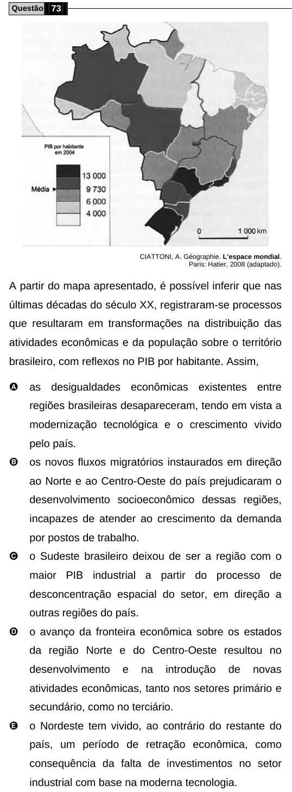

Texto extraído (pode conter ruído)

Questão 73  
CIATTONI, A. Géographie. L’espace mondial.  
Paris: Hatier, 2008 (adaptado).  
A partir do mapa apresentado, é possível inferir que nas  
últimas décadas do século XX, registraram-se processos  
que resultaram em transformações na distribuição das  
atividades econômicas e da população sobre o território  
brasileiro, com reflexos no PIB por habitante. Assim,  
A  
as desigualdades econômicas existentes entre  
regiões brasileiras desapareceram, tendo em vista a  
modernização tecnológica e o crescimento vivido  
pelo país.  
B  
os novos fluxos migratórios instaurados em direção  
ao Norte e ao Centro-Oeste do país prejudicaram o  
desenvolvimento socioeconômico dessas regiões,  
incapazes de atender ao crescimento da demanda  
por postos de trabalho.  
C  
o Sudeste brasileiro deixou de ser a região com o  
maior PIB industrial a partir do processo de  
desconcentração espacial do setor, em direção a  
outras regiões do país.  
D  
o avanço da fronteira econômica sobre os estados  
da região Norte e do Centro-Oeste resultou no  
desenvolvimento  
e  
na  
introdução  
de  
novas  
atividades econômicas, tanto nos setores primário e  
secundário, como no terciário.  
E  
o Nordeste tem vivido, ao contrário do restante do  
país, um período de retração econômica, como  
consequência da falta de investimentos no setor  
industrial com base na moderna tecnologia.

