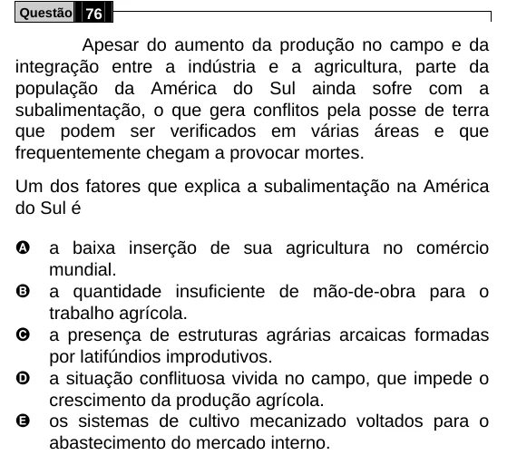

Texto extraído (pode conter ruído)

Questão 76  
Apesar do aumento da produção no campo e da  
integração entre a indústria e a agricultura, parte da  
população da América do Sul ainda sofre com a  
subalimentação, o que gera conflitos pela posse de terra  
que podem ser verificados em várias áreas e que  
frequentemente chegam a provocar mortes.  
Um dos fatores que explica a subalimentação na América  
do Sul é  
A  
a baixa inserção de sua agricultura no comércio  
mundial.  
B  
a quantidade insuficiente de mão-de-obra para o  
trabalho agrícola.  
C  
a presença de estruturas agrárias arcaicas formadas  
por latifúndios improdutivos.  
D  
a situação conflituosa vivida no campo, que impede o  
crescimento da produção agrícola.  
E  
os sistemas de cultivo mecanizado voltados para o  
abastecimento do mercado interno.

