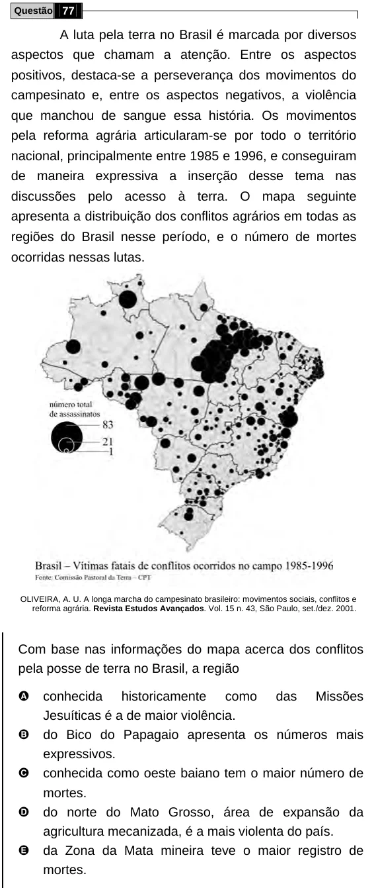

Texto extraído (pode conter ruído)

Questão 77  
A luta pela terra no Brasil é marcada por diversos  
aspectos que chamam a atenção. Entre os aspectos  
positivos, destaca-se a perseverança dos movimentos do  
campesinato e, entre os aspectos negativos, a violência  
que manchou de sangue essa história. Os movimentos  
pela reforma agrária articularam-se por todo o território  
nacional, principalmente entre 1985 e 1996, e conseguiram  
de maneira expressiva a inserção desse tema nas  
discussões pelo acesso à terra. O mapa seguinte  
apresenta a distribuição dos conflitos agrários em todas as  
regiões do Brasil nesse período, e o número de mortes  
ocorridas nessas lutas.  
OLIVEIRA, A. U. A longa marcha do campesinato brasileiro: movimentos sociais, conflitos e  
reforma agrária. Revista Estudos Avançados. Vol. 15 n. 43, São Paulo, set./dez. 2001.  
Com base nas informações do mapa acerca dos conflitos  
pela posse de terra no Brasil, a região  
A  
conhecida historicamente como das Missões  
Jesuíticas é a de maior violência.  
B  
do Bico do Papagaio apresenta os números mais  
expressivos.  
C  
conhecida como oeste baiano tem o maior número de  
mortes.  
D  
do norte do Mato Grosso, área de expansão da  
agricultura mecanizada, é a mais violenta do país.  
E  
da Zona da Mata mineira teve o maior registro de  
mortes.

