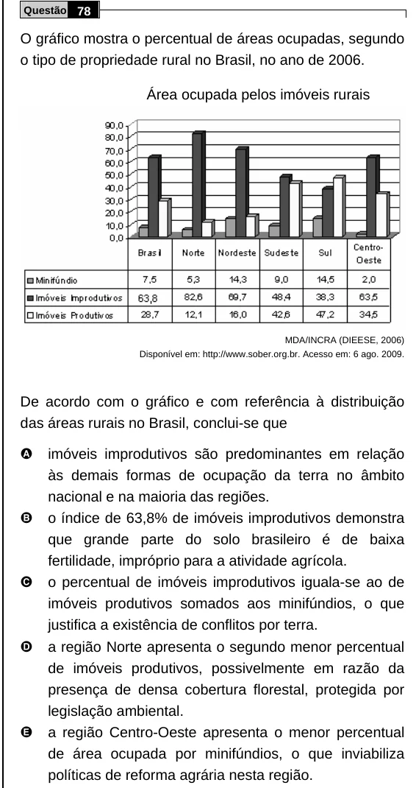

Texto extraído (pode conter ruído)

Questão 78  
O gráfico mostra o percentual de áreas ocupadas, segundo  
o tipo de propriedade rural no Brasil, no ano de 2006.  
Área ocupada pelos imóveis rurais  
MDA/INCRA (DIEESE, 2006)  
Disponível em: http://www.sober.org.br. Acesso em: 6 ago. 2009.  
De acordo com o gráfico e com referência à distribuição  
das áreas rurais no Brasil, conclui-se que  
A  
imóveis improdutivos são predominantes em relação  
às demais formas de ocupação da terra no âmbito  
nacional e na maioria das regiões.  
B  
o índice de 63,8% de imóveis improdutivos demonstra  
que grande parte do solo brasileiro é de baixa  
fertilidade, impróprio para a atividade agrícola.  
C  
o percentual de imóveis improdutivos iguala-se ao de  
imóveis produtivos somados aos minifúndios, o que  
justifica a existência de conflitos por terra.  
D  
a região Norte apresenta o segundo menor percentual  
de imóveis produtivos, possivelmente em razão da  
presença de densa cobertura florestal, protegida por  
legislação ambiental.  
E  
a região Centro-Oeste apresenta o menor percentual  
de área ocupada por minifúndios, o que inviabiliza  
políticas de reforma agrária nesta região.

