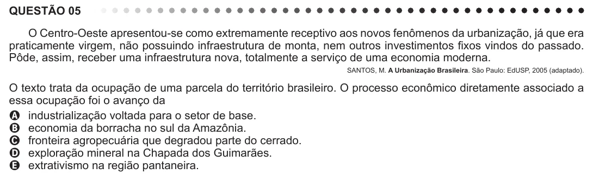

Texto extraído (pode conter ruído)

QUESTÃO 05  
O Centro-Oeste apresentou-se como extremamente receptivo aos novos fenômenos da urbanização, já que era  
praticamente virgem, não possuindo infraestrutura de monta, nem outros investimentos fixos vindos do passado.  
Pôde, assim, receber uma infraestrutura nova, totalmente a serviço de uma economia moderna.  
SANTOS, M. A Urbanização Brasileira. São Paulo: EdUSP, 2005 (adaptado).  
O texto trata da ocupação de uma parcela do território brasileiro. O processo econômico diretamente associado a  
essa ocupação foi o avanço da  
A industrialização voltada para o setor de base.  
B economia da borracha no sul da Amazônia.  
C fronteira agropecuária que degradou parte do cerrado.  
D exploração mineral na Chapada dos Guimarães.  
E extrativismo na região pantaneira.

