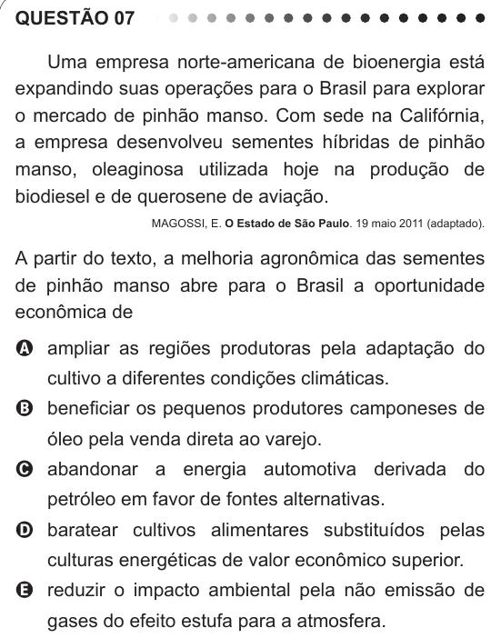

Texto extraído (pode conter ruído)

QUESTÃO 07  
Uma empresa norte-americana de bioenergia está  
expandindo suas operações para o Brasil para explorar  
o mercado de pinhão manso. Com sede na Califórnia,  
a empresa desenvolveu sementes híbridas de pinhão  
manso, oleaginosa utilizada hoje na produção de  
biodiesel e de querosene de aviação.  
MAGOSSI, E. O Estado de São Paulo. 19 maio 2011 (adaptado).  
A partir do texto, a melhoria agronômica das sementes  
de pinhão manso abre para o Brasil a oportunidade  
econômica de  
A ampliar as regiões produtoras pela adaptação do  
cultivo a diferentes condições climáticas.  
B beneficiar os pequenos produtores camponeses de  
óleo pela venda direta ao varejo.  
C abandonar a energia automotiva derivada do  
petróleo em favor de fontes alternativas.  
D baratear cultivos alimentares substituídos pelas  
culturas energéticas de valor econômico superior.  
E reduzir o impacto ambiental pela não emissão de  
gases do efeito estufa para a atmosfera.

