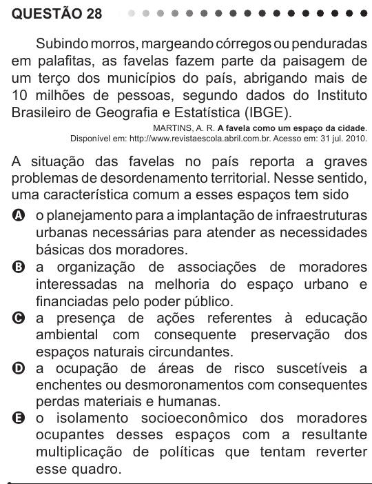

Texto extraído (pode conter ruído)

QUESTÃO 28  
Subindo morros, margeando córregos ou penduradas  
em palafitas, as favelas fazem parte da paisagem de  
um terço dos municípios do país, abrigando mais de  
10 milhões de pessoas, segundo dados do Instituto  
Brasileiro de Geografia e Estatística (IBGE).  
MARTINS, A. R. A favela como um espaço da cidade.  
Disponível em: http://www.revistaescola.abril.com.br. Acesso em: 31 jul. 2010.  
A situação das favelas no país reporta a graves  
problemas de desordenamento territorial. Nesse sentido,  
uma característica comum a esses espaços tem sido  
A o planejamento para a implantação de infraestruturas  
urbanas necessárias para atender as necessidades  
básicas dos moradores.  
B a organização de associações de moradores  
interessadas na melhoria do espaço urbano e  
financiadas pelo poder público.  
C a presença de ações referentes à educação  
ambiental com consequente preservação dos  
espaços naturais circundantes.  
D a ocupação de áreas de risco suscetíveis a  
enchentes ou desmoronamentos com consequentes  
perdas materiais e humanas.  
E o isolamento socioeconômico dos moradores  
ocupantes desses espaços com a resultante  
multiplicação de políticas que tentam reverter  
esse quadro.

