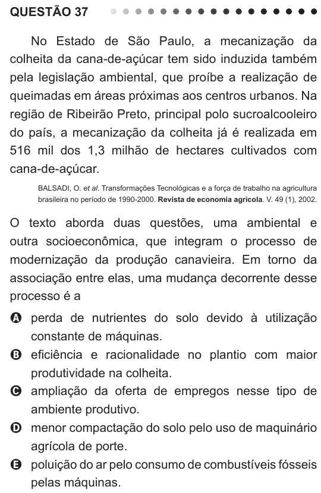

Texto extraído (pode conter ruído)

QUESTÃO 37  
No Estado de São Paulo, a mecanização da  
colheita da cana-de-açúcar tem sido induzida também  
pela legislação ambiental, que proíbe a realização de  
queimadas em áreas próximas aos centros urbanos. Na  
região de Ribeirão Preto, principal polo sucroalcooleiro  
do país, a mecanização da colheita já é realizada em  
516 mil dos 1,3 milhão de hectares cultivados com  
cana-de-açúcar.  
BALSADI, O. et al. Transformações Tecnológicas e a força de trabalho na agricultura  
brasileira no período de 1990-2000. Revista de economia agrícola. V. 49 (1), 2002.  
O texto aborda duas questões, uma ambiental e  
outra socioeconômica, que integram o processo de  
modernização da produção canavieira. Em torno da  
associação entre elas, uma mudança decorrente desse  
processo é a  
A perda de nutrientes do solo devido à utilização  
constante de máquinas.  
B eficiência e racionalidade no plantio com maior  
produtividade na colheita.  
C ampliação da oferta de empregos nesse tipo de  
ambiente produtivo.  
D menor compactação do solo pelo uso de maquinário  
agrícola de porte.  
E poluição do ar pelo consumo de combustíveis fósseis  
pelas máquinas.

