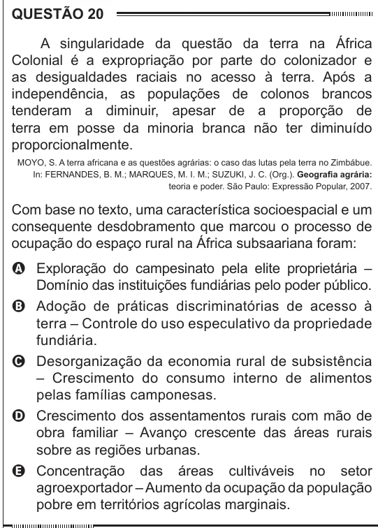

Texto extraído (pode conter ruído)

QUESTÃO 20  
A singularidade da questão da terra na África  
Colonial é a expropriação por parte do colonizador e  
as desigualdades raciais no acesso à terra. Após a  
independência, as populações de colonos brancos  
tenderam a diminuir, apesar de a proporção de  
terra em posse da minoria branca não ter diminuído  
proporcionalmente.  
MOYO, S. A terra africana e as questões agrárias: o caso das lutas pela terra no Zimbábue.  
In: FERNANDES, B. M.; MARQUES, M. I. M.; SUZUKI, J. C. (Org.). Geografia agrária:  
teoria e poder. São Paulo: Expressão Popular, 2007.  
Com base no texto, uma característica socioespacial e um  
consequente desdobramento que marcou o processo de  
ocupação do espaço rural na África subsaariana foram:  
A Exploração do campesinato pela elite proprietária –  
Domínio das instituições fundiárias pelo poder público.  
B Adoção de práticas discriminatórias de acesso à  
terra – Controle do uso especulativo da propriedade  
fundiária.  
C Desorganização da economia rural de subsistência  
– Crescimento do consumo interno de alimentos  
pelas famílias camponesas.  
D Crescimento dos assentamentos rurais com mão de  
obra familiar – Avanço crescente das áreas rurais  
sobre as regiões urbanas.  
E Concentração das áreas cultiváveis no setor  
agroexportador – Aumento da ocupação da população  
pobre em territórios agrícolas marginais.

