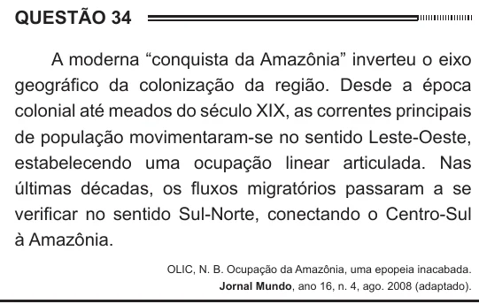

Texto extraído (pode conter ruído)

QUESTÃO 34  
A moderna “conquista da Amazônia” inverteu o eixo  
geográfico da colonização da região. Desde a época  
colonial até meados do século XIX, as correntes principais  
de população movimentaram-se no sentido Leste-Oeste,  
estabelecendo uma ocupação linear articulada. Nas  
últimas décadas, os fluxos migratórios passaram a se  
verificar no sentido Sul-Norte, conectando o Centro-Sul  
à Amazônia.  
OLIC, N. B. Ocupação da Amazônia, uma epopeia inacabada.  
Jornal Mundo, ano 16, n. 4, ago. 2008 (adaptado).  
O primeiro eixo geográfico de ocupação das terras  
amazônicas demonstra um padrão relacionado à  
criação de  
núcleos urbanos em áreas litorâneas.  
A  
centros agrícolas modernos no interior.  
B  
vias férreas entre espaços de mineração.  
C  
D  
faixas de povoamento ao longo das estradas.  
povoados interligados próximos a grandes rios.  
E

