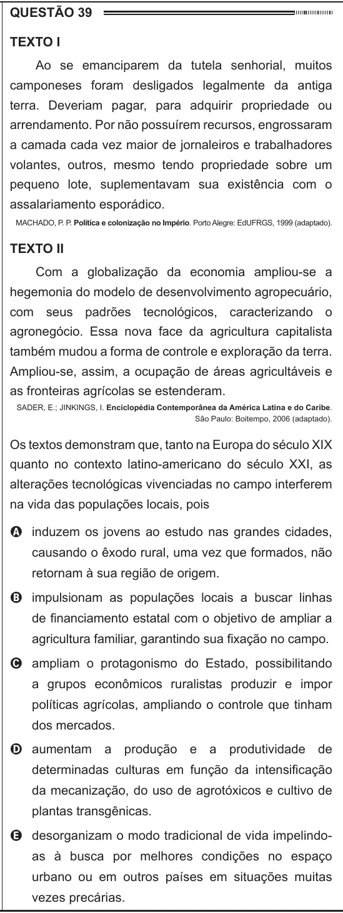

Texto extraído (pode conter ruído)

QUESTÃO 39  
Texto I  
Ao se emanciparem da tutela senhorial, muitos  
camponeses foram desligados legalmente da antiga  
terra. Deveriam pagar, para adquirir propriedade ou  
arrendamento. Por não possuírem recursos, engrossaram  
a camada cada vez maior de jornaleiros e trabalhadores  
volantes, outros, mesmo tendo propriedade sobre um  
pequeno lote, suplementavam sua existência com o  
assalariamento esporádico.  
MACHADO, P. P. Política e colonização no Império. Porto Alegre: EdUFRGS, 1999 (adaptado).  
Texto II  
Com a globalização da economia ampliou-se a  
hegemonia do modelo de desenvolvimento agropecuário,  
com seus padrões tecnológicos, caracterizando o  
agronegócio. Essa nova face da agricultura capitalista  
também mudou a forma de controle e exploração da terra.  
Ampliou-se, assim, a ocupação de áreas agricultáveis e  
as fronteiras agrícolas se estenderam.  
SADER, E.; JINKINGS, I. Enciclopédia Contemporânea da América Latina e do Caribe.  
São Paulo: Boitempo, 2006 (adaptado).  
Os textos demonstram que, tanto na Europa do século XIX  
quanto no contexto latino-americano do século XXI, as  
alterações tecnológicas vivenciadas no campo interferem  
na vida das populações locais, pois  
A induzem os jovens ao estudo nas grandes cidades,  
causando o êxodo rural, uma vez que formados, não  
retornam à sua região de origem.  
B impulsionam as populações locais a buscar linhas  
de financiamento estatal com o objetivo de ampliar a  
agricultura familiar, garantindo sua fixação no campo.  
C ampliam o protagonismo do Estado, possibilitando  
a grupos econômicos ruralistas produzir e impor  
políticas agrícolas, ampliando o controle que tinham  
dos mercados.  
D aumentam a produção e a produtividade de  
determinadas culturas em função da intensificação  
da mecanização, do uso de agrotóxicos e cultivo de  
plantas transgênicas.  
E desorganizam o modo tradicional de vida impelindo-  
as à busca por melhores condições no espaço  
urbano ou em outros países em situações muitas  
vezes precárias.

