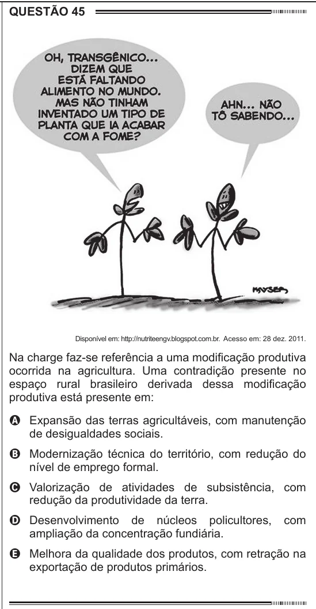

Texto extraído (pode conter ruído)

QUESTÃO 45  
Disponível em: http://nutriteengv.blogspot.com.br. Acesso em: 28 dez. 2011.  
Na charge faz-se referência a uma modificação produtiva  
ocorrida na agricultura. Uma contradição presente no  
espaço rural brasileiro derivada dessa modificação  
produtiva está presente em:  
A Expansão das terras agricultáveis, com manutenção  
de desigualdades sociais.  
B Modernização técnica do território, com redução do  
nível de emprego formal.  
C Valorização de atividades de subsistência, com  
redução da produtividade da terra.  
D Desenvolvimento de núcleos policultores,  
com  
ampliação da concentração fundiária.  
E Melhora da qualidade dos produtos, com retração na  
exportação de produtos primários.  
CIÊNCIAS DA NATUREZA			 QUESTÃO 49  
E SUAS TECNOLOGIAS  
Questões de 46 a 90

