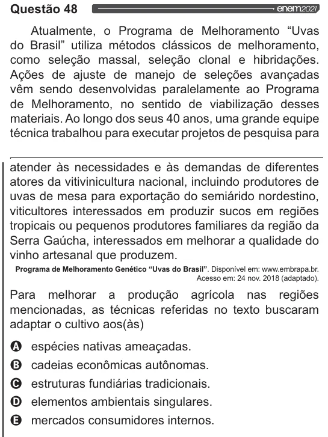

Texto extraído (pode conter ruído)

Questão 48  
Atualmente, o Programa de Melhoramento “Uvas  
do Brasil” utiliza métodos clássicos de melhoramento,  
como seleção massal, seleção clonal e hibridações.  
Ações de ajuste de manejo de seleções avançadas  
vêm sendo desenvolvidas paralelamente ao Programa  
de Melhoramento, no sentido de viabilização desses  
materiais. Ao longo dos seus 40 anos, uma grande equipe  
técnica trabalhou para executar projetos de pesquisa para  
atender às necessidades e às demandas de diferentes  
atores da vitivinicultura nacional, incluindo produtores de  
uvas de mesa para exportação do semiárido nordestino,  
viticultores interessados em produzir sucos em regiões  
tropicais ou pequenos produtores familiares da região da  
Serra Gaúcha, interessados em melhorar a qualidade do  
vinho artesanal que produzem.  
Programa de Melhoramento Genético “Uvas do Brasil”. Disponivel em: www.embrapa.br.  
Acesso em: 24 nov. 2018 (adaptado).  
Para melhorar a produção agrícola nas regiões  
mencionadas, as técnicas referidas no texto buscaram  
adaptar o cultivo aos(às)  
Q espécies nativas ameaçadas.  
O cadeias econômicas autônomas.  
O estruturas fundiárias tradicionais.  
O elementos ambientais singulares.  
& mercados consumidores internos.

