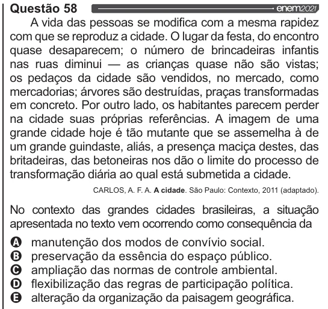

Texto extraído (pode conter ruído)

Questão 58  
A vida das pessoas se modifica com a mesma rapidez  
com que se reproduz a cidade. O lugar da festa, do encontro  
quase desaparecem; o número de brincadeiras infantis  
nas ruas diminui — as crianças quase não são vistas;  
os pedaços da cidade são vendidos, no mercado, como  
mercadorias; árvores são destruídas, praças transformadas  
em concreto. Por outro lado, os habitantes parecem perder  
na cidade suas próprias referências. A imagem de uma  
grande cidade hoje é tão mutante que se assemelha à de  
um grande guindaste, aliás, a presença maciça destes, das  
britadeiras, das betoneiras nos dão o limite do processo de  
transformação diária ao qual está submetida a cidade.  
CARLOS, A. F.A. A cidade. São Paulo: Contexto, 2011 (adaptado).  
No contexto das grandes cidades brasileiras, a situação  
apresentada no texto vem ocorrendo como consequência da  
Q manutenção dos modos de convívio social.  
O preservação da essência do espaço público.  
O ampliação das normas de controle ambiental.  
O flexibilização das regras de participação política.  
& alteração da organização da paisagem geográfica.

