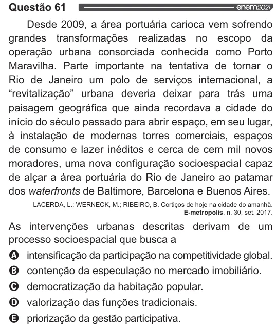

Texto extraído (pode conter ruído)

Questão 61  
Desde 2009, a área portuária carioca vem sofrendo  
grandes transformações realizadas no escopo da  
operação urbana consorciada conhecida como Porto  
Maravilha. Parte importante na tentativa de tornar o  
Rio de Janeiro um polo de serviços internacional, a  
“revitalização” urbana deveria deixar para trás uma  
paisagem geográfica que ainda recordava a cidade do  
início do século passado para abrir espaço, em seu lugar,  
à instalação de modernas torres comerciais, espaços  
de consumo e lazer inéditos e cerca de cem mil novos  
moradores, uma nova configuração socioespacial capaz  
de alçar a área portuária do Rio de Janeiro ao patamar  
dos waterfronts de Baltimore, Barcelona e Buenos Aires.  
LACERDA, L.; WERNECK, M.; RIBEIRO, B. Cortiços de hoje na cidade do amanhã.  
E-metropolis, n. 30, set. 2017.  
As intervenções urbanas descritas derivam de um  
processo socioespacial que busca a  
intensificação da participação na competitividade global.  
contenção da especulação no mercado imobiliário.  
democratização da habitação popular.  
valorização das funções tradicionais.  
priorização da gestão participativa.

